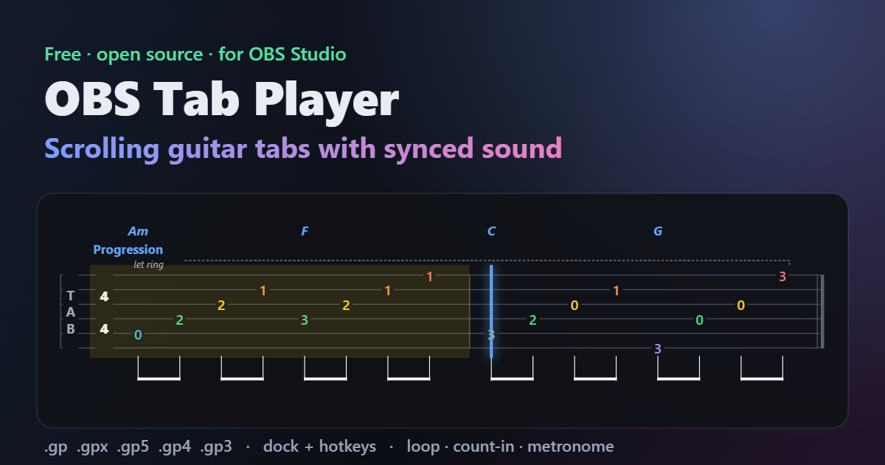

# OBS Tab Player

**Scrolling guitar tabs with synced sound, right inside OBS Studio.**

A native OBS plugin: add the **Tab Player** to your scene, pick a tab in the **Tab Player** panel
and press Play. One line of tab scrolls under your camera with a cursor, the notes light up, and
the sound plays through OBS's own mixer, so it is in every recording and stream. The guitar and
the metronome each get their own fader.

[**Website and live demo**](https://bask209.github.io/obs-tab-player/) ·
[**Download**](https://github.com/bask209/obs-tab-player/releases/latest) ·
[Report a problem](https://github.com/bask209/obs-tab-player/issues)



## Install (Windows 10/11, OBS 30 or newer)

1. Download **`obs-tab-player-<version>-windows-x64-setup.exe`** from
   [Releases](https://github.com/bask209/obs-tab-player/releases/latest) and run it. It asks for
   administrator rights because OBS plugins live in `C:\ProgramData\obs-studio\plugins`, and
   offers to close OBS if it is open. The installer is not code-signed, so SmartScreen may show
   "Windows protected your PC": click **More info › Run anyway**.
2. Start OBS. The **Tab Player** panel opens on the right with two buttons:
   **Choose your tabs folder** and **Add Tab Player to this scene**.
3. Pick a tab, press **Play**.

That's all. To remove it: Windows Settings › Apps › **OBS Tab Player** › Uninstall.

Prefer no installer? Download the `.zip` instead, extract it and run **Install.cmd** (remove it
with **Uninstall.cmd**). Releases are built by GitHub Actions from this source, with SHA-256
checksums and build-provenance attestations
(`gh attestation verify <file> -R bask209/obs-tab-player`).

## Using it

- **Find a tab:** type a day number (`12`), a range (`10-20`) or a word (`sweep`). Click a tab to
  open it; double-click or press Enter to play it. You can also drop tab files or a folder onto the
  panel. **Up next** continues your daily routine with one click.
- **Tempo:** set the BPM or use −/+, the 50–125% presets, or the tempo range written in the tab
  (for example 40 · 80 · 120). Speed changes take effect immediately, even while playing.
- **Practice:** Loop (whole tab or chosen bars), Count-in, Metronome.
- **Two faders:** the Audio Mixer shows **Tab Player** (the guitar) and **Tab Player Metronome**
  (metronome and count-in clicks). Set each volume separately, mute one, or send them to
  different tracks in *Advanced Audio Properties*, for example the click only to your headphones.
- **Look:** turn on **Floating tab** and only the notation floats over your video, with no card or
  title panel. A soft outline keeps it readable on any background. The **Background** slider sets
  anything in between. The tab is one scrolling line by default, sized to sit along the bottom
  of the picture; *Rows* lays it out like a page instead. There are also six themes, coloured
  strings and fonts. *Fit to source* (on by default) sizes the notation to whatever size you give the
  source in your scene.
- **Sound:** clean, warm or crunch tone; guitar and click volume; cursor offset.
- **Hotkeys** (Settings › Hotkeys, search "Tab Player"): play/pause, stop, restart, next/previous
  day, next/previous tab, faster, slower, normal speed, loop, metronome, count-in, exercise text.

Formats: Guitar Pro 7/8 (`.gp`), Guitar Pro 6 (`.gpx`), Guitar Pro 3–5 (`.gp3`, `.gp4`, `.gp5`).
Any number of strings, so 6/7-string guitar and bass tabs work.

The notation follows Guitar Pro: bends rise to an arrow with the amount (full, ½, …), holds are a
dashed line and releases come back down, without repeating tied fret numbers; tempo and swing
("triplet feel") marks sit above the first bar; the file's own beaming is kept. Playback matches:
swing bars are played swung, and a bend carries on through tied notes (bend, hold, release).

## Performance

Measured inside OBS 32.2.2 on Windows 11 (`tests/obs-native-e2e.mjs`, 1280×720 source, 30 FPS).
The plugin times its own work and logs it every 10 s while playing:

| While playing | Per unit | Share of one CPU core |
|---|---|---|
| Video (card + panel) | ~15 µs per frame | ~0.05% |
| Video (floating tab) | ~9–10 µs per frame | ~0.03% |
| Audio | 4–20 µs per 20 ms block | 0.02–0.1% |

When paused, there is no audio work at all and the threads sleep. OBS's own counters show no
measurable difference between OBS idle and OBS playing a tab, and no frames are skipped.

What keeps it light:
- The tab is drawn once with Direct2D, in 1024 px tiles and only where visible. Each video frame
  draws a handful of quads in three batched passes, with no per-frame allocation.
- Texture uploads are spread over frames (at most two per frame), so there are no hitches.
- Each pitch is synthesized once. Playback mixes pre-rendered buffers, and pitch bends are
  evaluated every 16 samples rather than every sample.
- Audio is produced in 20 ms blocks (50 wake-ups per second while playing); idle threads sleep
  until needed.
- There is no browser engine, no web server and no runtime: one 600 KB DLL.

Engine speed (all 688 files of a 365-day exercise library): parsing takes 7 µs, the timeline 5 µs
and the layout 24 µs per file on average.

## Safety

Tab files are treated as untrusted input. See [SECURITY.md](SECURITY.md) for details. In short:
- **Hard limits:** every read is bounds-checked, with hard limits on sizes, counts and values.
- **No regex:** there is no `std::regex`, so no input can cause runaway recursion.
- **Fuzzed:** 2.5 million fuzzed files ran under AddressSanitizer with no crash.
- **No leaks:** a 13,760-cycle soak test showed no memory growth.
- **Hardened build:** warnings as errors, SDL checks, Control Flow Guard, CET.
- **No exceptions into OBS:** none can cross into OBS, and the audio and render threads are always
  joined on shutdown.

## How it works

```
plugin/src/core     portable engine (C++17, no dependencies)
  gp3to5.cpp          Guitar Pro 3/4/5 reader
  containers.cpp      GPX (BCFZ/BCFS) and ZIP containers, own DEFLATE decoder
  gpif.cpp            GPIF (Guitar Pro 6/7/8) XML reader
  timeline.cpp        repeats, alternate endings, tempo map, ties, let-ring, bends, slides
  layout.cpp          tab layout -> drawing primitives + cursor geometry
  synth.cpp           sample-accurate player, Karplus-Strong strings, metronome, soft limiter
  library.cpp         folder scan, "Day 004 - A - Arpeggios" names, search, notes parsing
plugin/src/win      Direct2D/DirectWrite renderer (built into Windows)
plugin/src/obs      the OBS source (render thread draws, worker thread renders) and the engine
plugin/src/ui       the Qt dock
```

Sync is exact by construction. The audio thread stamps every 20 ms block with its OBS timestamp
and records which sample it starts at, and the source asks for the song position at each video
frame's timestamp. Picture and sound come from one clock.

## Building

Needs Visual Studio 2022, CMake 3.28+, the OBS SDK (libobs, obs-frontend-api) with Qt 6, and
Inno Setup 6 for the installer (`winget install JRSoftware.InnoSetup`):

`tools/obs-sdk.ps1` downloads (SHA-256 pinned) and builds the OBS SDK into `.deps`:

```bash
powershell -File tools/obs-sdk.ps1
```

```bash
cmake -S plugin -B build/plugin -DCMAKE_PREFIX_PATH="$PWD/.deps;$PWD/.deps/qt6;$PWD/.deps/deps"
```

```bash
cmake --build build/plugin --config Release
```

```bash
powershell -File tools/package-plugin.ps1
```

The engine and `tabtool` (dump, render to PNG, render to WAV, benchmark, soak) build without OBS:

```bash
cmake -S plugin -B build/tools -DTAB_BUILD_PLUGIN=OFF
```

```bash
cmake --build build/tools --config Release
```

To build and run the fuzzer with AddressSanitizer:

```bash
cmake -S plugin -B build/fuzz -DTAB_BUILD_PLUGIN=OFF -DTAB_FUZZ=ON
```

```bash
cmake --build build/fuzz --config Release
```

Tests (Node 20+):
- `npm test` runs format round trips for every version, engine, server and performance tests, and
  checks that the C++ reader and timeline match the JS ones (when `tabtool` is built).
- `node tests/obs-native-e2e.mjs --obs <portable OBS> --library <tabs>` runs the plugin in a real
  OBS, plays via hotkeys, and reports CPU, memory, frame stats and log errors.

## Browser edition (macOS and Linux)

The native plugin is Windows-only for now. `player/` contains a cross-platform edition: an OBS Lua
script plus a Browser Source overlay and dock, using the same engine in JavaScript. It is also what
powers the live demo on the website. It costs more CPU and memory (OBS's browser engine) but runs
anywhere OBS does.

## License

Apache License 2.0, see [LICENSE](LICENSE). All code in this repository is original. The compiled
plugin links against libobs (GPL-2.0-or-later) when it runs inside OBS, like every OBS plugin.
Guitar Pro is a trademark of its owner; this project is not affiliated with Arobas Music or the OBS
Project.
