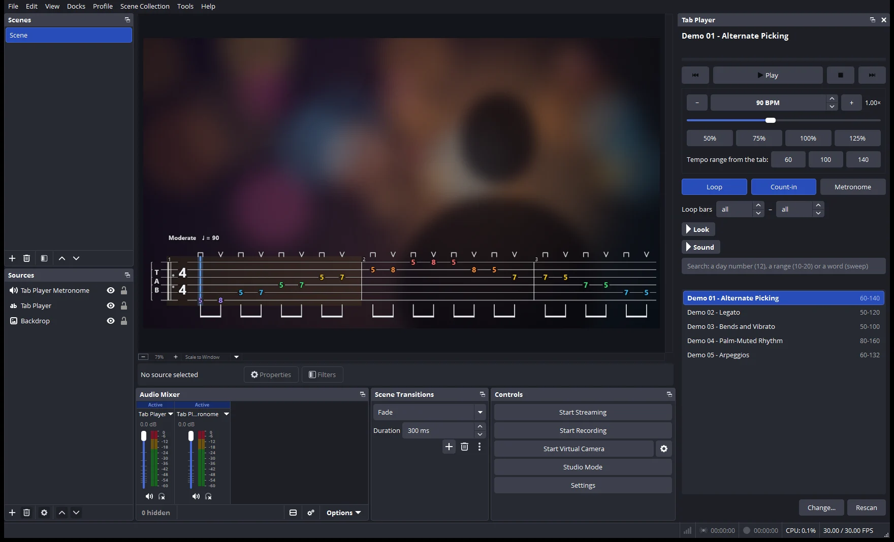
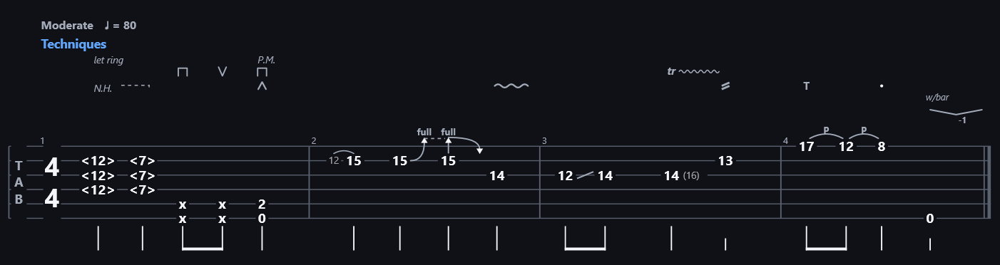

# OBS Tab Player

**Scrolling guitar tabs with synced sound, right inside OBS Studio.**

A free, open-source OBS Studio plugin for Windows, macOS and Linux that plays Guitar Pro tabs
(.gp, .gpx, .gp5, .gp4, .gp3) on screen for guitar and bass practice, lessons and streams. Add the **Tab Player** to your scene, pick a tab in the **Tab Player** panel
and press Play. One line of tab scrolls under your camera with a cursor, the notes light up, and
the sound plays through OBS's own mixer, so it is in every recording and stream. The guitar and
the metronome each get their own fader.

[**Website and live demo**](https://bask209.github.io/obs-tab-player/) ·
[**Getting started**](https://bask209.github.io/obs-tab-player/start.html) ·
[**Download**](https://github.com/bask209/obs-tab-player/releases/latest) ·
[Changelog](CHANGELOG.md) ·
[Report a problem](https://github.com/bask209/obs-tab-player/issues)



## Install (OBS 30 or newer)

Download the file for your system from
[Releases](https://github.com/bask209/obs-tab-player/releases/latest). None of them needs
administrator rights.

**Windows 10/11:** run **`obs-tab-player-<version>-windows-x64-setup.exe`**. It copies the plugin
into OBS's plugin folder (`C:\ProgramData\obs-studio\plugins`) and offers to close OBS if it is
open. The installer is not code-signed, so SmartScreen may show "Windows protected your PC": click
**More info › Run anyway**. To remove it: Windows Settings › Apps › **OBS Tab Player** › Uninstall.
Prefer no installer? Use the `windows-x64.zip` and its **Install.cmd** / **Uninstall.cmd**.

**macOS 11 or newer (Apple silicon and Intel), new and not yet tried on a real Mac:** please
[report](https://github.com/bask209/obs-tab-player/issues) how it goes. Unzip **`obs-tab-player-<version>-macos-universal.zip`**,
quit OBS and double-click **Install.command**. It copies the plugin into
`~/Library/Application Support/obs-studio/plugins`. The plugin is not signed with a paid Apple
developer certificate, so the first time macOS asks: Control-click **Install.command**, choose
**Open**, then **Open** again. Remove it with **Uninstall.command**.

**Linux (x86_64):** for OBS from the OBS PPA, your distribution or OBS's .deb (not the Flatpak).
Extract **`obs-tab-player-<version>-linux-x86_64.tar.gz`**, close OBS and run `./install.sh`: it copies
the plugin into `~/.config/obs-studio/plugins`. Or install the system package
**`obs-tab-player_<version>_amd64.deb`**. Remove it with `./uninstall.sh` (or remove the package).

Then start OBS. The **Tab Player** panel opens on the right with two buttons: **Choose your tabs
folder** and **Add Tab Player to this scene**. Pick a tab, press **Play**. New to OBS or to the
plugin? The [Getting started guide](https://bask209.github.io/obs-tab-player/start.html) walks
through it with pictures, including where the six practice tabs are and what to do if something
isn't working.

Releases are built by GitHub Actions from this source for all three systems, tested inside OBS on
Windows and Linux, with SHA-256 checksums and build-provenance attestations
(`gh attestation verify <file> -R bask209/obs-tab-player`).

## Using it

- **Find a tab:** type a day number (`12`), a range (`10-20`) or a word (`sweep`). Click a tab to
  open it; double-click or press Enter to play it. You can also drop tab files or a folder onto the
  panel. The panel keeps the player at the top and four pages below it: **Tabs**, **Practice**,
  **Look** and **Sound**. Each settings page has **Reset to defaults**, and the mouse wheel only
  scrolls: it never changes a setting.
- **Your tabs folder:** pick it with **Choose your tabs folder** (later **Change…**); subfolders are
  included and the list is sorted by day number, then name. Switch folders any time, for example
  from an exercise book to your songs.
- **Stars and practice history:** click the ☆ in front of a tab (or next to its title, or use the
  hotkey) to star it, and **★ Starred** shows only those (it stays on until you turn it off). When
  OBS starts, the panel opens the starred tab you played last. Each tab also shows when you last played
  it ("played today", "played 3 days ago"). Each folder keeps its own stars.
- **Tempo:** set the BPM or use −/+, the 50–125% presets, or the tempo range written in the tab
  (for example 40 · 80 · 120). Speed changes take effect immediately, even while playing.
- **Practice:** Loop (whole tab or chosen bars), Count-in, Metronome.
- **Two faders:** the Audio Mixer shows **Tab Player** (the guitar) and **Tab Player Metronome**
  (metronome and count-in clicks). Set each volume separately, mute one, or send them to
  different tracks in *Advanced Audio Properties*, for example the click only to your headphones.
- **Look:** turn on **Floating tab** and only the notation floats over your video, with no card or
  title panel. A soft outline keeps it readable on any background. The **Background** slider sets
  anything in between. The tab is one scrolling line by default, sized to sit along the bottom
  of the picture; *Rows* lays it out like a page instead. There are also six themes, coloured
  strings and fonts. *Fit to source* (on by default) sizes the notation to whatever size you give the
  source in your scene.
- **Sound:** clean, warm or crunch tone; guitar and click volume; cursor offset.
- **Hotkeys** (Settings › Hotkeys, search "Tab Player"): play/pause, stop, restart, next/previous
  day, next/previous tab, faster, slower, normal speed, loop, metronome, count-in, exercise text,
  star / unstar this tab.

Formats: Guitar Pro 7/8 (`.gp`), Guitar Pro 6 (`.gpx`), Guitar Pro 3–5 (`.gp3`, `.gp4`, `.gp5`).
Any number of strings, so 6/7-string guitar and bass tabs work.

The notation follows Guitar Pro:



- **Bends** rise to an arrow with the amount (full, ½, …), holds are a dashed line and releases
  come back down.
- **Whammy bar** dives and dips are drawn as a line with the amount in tones (`w/bar`, -1, -½).
- **Tied notes** are written again, in brackets, only at the start of a bar.
- **Grace notes** are small frets just before the note, with their slur or slide.
- **Harmonics** are labelled N.H., A.H., P.H., T.H. and S.H. Natural harmonics show where they
  are touched (`<12>`, `<3.2>`); the others show where they sound (`5 <17>`).
- **Effects** sit above the tab: let ring, P.M., trills (`5 (7)` with "tr"), vibrato (slight or
  wide, as long as the note), tremolo picking slashes, fade-in, tap, slap and pop (T, S, P), pick
  strokes, accents (`>` and `^`) and staccato. Each kind keeps its own lane, and kinds that never
  meet share one, so a single line of tab stays low.
- **Strums** (brush up or down) are an arrow beside the chord.
- **Rhythm:** dotted and double-dotted notes and rests, and tuplets with their number, plus a
  bracket when they aren't one beamed group. The file's own beaming is kept. Whole-bar rests sit
  in the middle of the bar.
- **Above the first bar:** tempo, swing ("triplet feel") and capo. Tempo changes are shown where
  they happen.
- **Song structure:** repeats with their count, endings (one bracket over all their bars),
  segno, coda and fine signs, D.C., D.S. and "To Coda", and fermatas.
- **Dynamics** (ppp to fff) are written under the tab where they change.

Playback matches what is written:
- Repeats, endings and the D.C., D.S., coda and fine jumps are followed in Guitar Pro's order.
  After a jump back, repeats are not played again.
- Swing bars are played swung; fermatas hold their beat longer.
- Bends and the whammy bar move the pitch, also through tied notes.
- Trills alternate the two frets; harmonics sound at the partial of the point you touch.
- Grace notes are played just before their note without taking time from the bar.

Left-hand fingering numbers are not drawn: Guitar Pro shows them on the standard notation staff,
which this player does not draw.

## Performance

Measured inside OBS 32.2.2 on Windows 11 (`tests/obs-native-e2e.mjs`, 1280×720 source, 30 FPS).
The plugin times its own work and logs it every 10 s while playing:

| While playing | Per unit | Share of one CPU core |
|---|---|---|
| Video (card + panel) | ~15 µs per frame | ~0.05% |
| Video (floating tab) | ~9–10 µs per frame | ~0.03% |
| Audio | 4–20 µs per 20 ms block | 0.02–0.1% |

When paused, there is no audio work at all and the threads sleep. OBS's own counters show no
measurable difference between OBS idle and OBS playing a tab, and no frames are skipped.

What keeps it light:
- The tab is drawn once with Qt's painter (OBS ships Qt), in 1024 px tiles and only where visible. Each video frame
  draws a handful of quads in three batched passes, with no per-frame allocation.
- Texture uploads are spread over frames (at most two per frame), so there are no hitches.
- Each pitch is synthesized once. Playback mixes pre-rendered buffers, and pitch bends are
  evaluated every 16 samples rather than every sample.
- Audio is produced in 20 ms blocks (50 wake-ups per second while playing); idle threads sleep
  until needed.
- There is no browser engine, no web server and no runtime of its own: one small module that
  uses OBS's own Qt.

Engine speed (all 688 files of a 365-day exercise library): parsing takes 7 µs, the timeline 5 µs
and the layout 24 µs per file on average.

## Safety

Tab files are treated as untrusted input. See [SECURITY.md](SECURITY.md) for details. In short:
- **Hard limits:** every read is bounds-checked, with hard limits on sizes, counts and values.
- **No regex:** there is no `std::regex`, so no input can cause runaway recursion.
- **Fuzzed:** 5.2 million fuzzed files ran under AddressSanitizer with no crash. One hang the fuzzer
  found (a damaged .gpx file) is fixed and kept as a test.
- **No leaks:** a 13,760-cycle soak test showed no memory growth.
- **Hardened build:** warnings as errors, SDL checks, Control Flow Guard, CET.
- **No exceptions into OBS:** none can cross into OBS, and the audio and render threads are always
  joined on shutdown.

## How it works

```
plugin/src/core     portable engine (C++17, no dependencies)
  gp3to5.cpp          Guitar Pro 3/4/5 reader
  containers.cpp      GPX (BCFZ/BCFS) and ZIP containers, own DEFLATE decoder
  gpif.cpp            GPIF (Guitar Pro 6/7/8) XML reader
  timeline.cpp        repeats, alternate endings, tempo map, ties, let-ring, bends, slides
  layout.cpp          tab layout -> drawing primitives + cursor geometry
  synth.cpp           sample-accurate player, Karplus-Strong strings, metronome, soft limiter
  json.cpp            the score, timeline and layout as JSON (website, tests, tabtool)
  library.cpp         folder scan, "Day 004 - A - Arpeggios" names, search, notes parsing
plugin/src/render   the renderer: Qt's painter into images (same on Windows, macOS and Linux)
plugin/src/obs      the OBS source (render thread draws, worker thread renders) and the engine
plugin/src/ui       the Qt dock
plugin/src/web      the engine as WebAssembly for the website: a small C interface and its
                    JavaScript wrapper (core.mjs), which also turns a layout into SVG
docs/               the website; its player (site.js, tabview.js, audio.js) runs that engine
```

There is one engine. The website's player is the same C++ code compiled to WebAssembly: it reads
the file, lays out the tab and plays it with the plugin's synth, in the visitor's browser (files
you open there are never uploaded). The tests run that build too, so they test the code that runs
in OBS.

Sync is exact by construction. The audio thread stamps every 20 ms block with its OBS timestamp
and records which sample it starts at, and the source asks for the song position at each video
frame's timestamp. Picture and sound come from one clock.

## Building

The plugin needs CMake 3.28+ and the OBS SDK (libobs, obs-frontend-api) with Qt 6.
`.github/workflows/ci.yml` builds it on all three systems and is the reference.

**Linux** (Ubuntu 24.04): install OBS's own package, which includes the SDK (`sudo apt install
obs-studio` from the OBS PPA, or OBS's .deb), plus `qt6-base-dev` and `ninja-build`; then
`cmake -S plugin -B build/plugin -G Ninja -DCMAKE_BUILD_TYPE=Release && cmake --build build/plugin`.
`tools/package-linux.sh` makes the tar.gz and the .deb.

**macOS** (Xcode): `tools/obs-sdk.sh` builds the SDK into `.deps` (SHA-256 pinned), then
`cmake -S plugin -B build/plugin -G Xcode -DCMAKE_PREFIX_PATH="$PWD/.deps;$PWD/.deps/qt6;$PWD/.deps/deps" "-DCMAKE_OSX_ARCHITECTURES=arm64;x86_64"`
and `cmake --build build/plugin --config Release`. `tools/package-macos.sh` makes the zip.

**Windows**: Visual Studio 2022, and Inno Setup 6 for the installer
(`winget install JRSoftware.InnoSetup`). `tools/obs-sdk.ps1` downloads (SHA-256 pinned) and
builds the OBS SDK into `.deps`:

```bash
powershell -File tools/obs-sdk.ps1
```

```bash
cmake -S plugin -B build/plugin -DCMAKE_PREFIX_PATH="$PWD/.deps;$PWD/.deps/qt6;$PWD/.deps/deps"
```

```bash
cmake --build build/plugin --config Release
```

```bash
powershell -File tools/package-plugin.ps1
```

The engine and `tabtool` (dump, timeline, layout, render to PNG, render to WAV, benchmark, soak)
build without OBS:

```bash
cmake -S plugin -B build/tools -DTAB_BUILD_PLUGIN=OFF
```

```bash
cmake --build build/tools --config Release
```

The engine as WebAssembly (website and tests) needs [Emscripten](https://emscripten.org) at the
version pinned in `package.json` (`emsdk install <version>` then `emsdk activate <version>`).
Put `em++` on PATH, or set `EMSDK` to the emsdk folder:

```bash
npm run web
```

`npm run site` also assembles the website in `_site/`; `node tools/serve-site.mjs` serves it locally.

To build and run the fuzzer with AddressSanitizer:

```bash
cmake -S plugin -B build/fuzz -DTAB_BUILD_PLUGIN=OFF -DTAB_FUZZ=ON
```

```bash
cmake --build build/fuzz --config Release
```

Tests (Node 20+):
- `npm test` builds the engine as WebAssembly and runs, on it: format round trips for every
  version, playback (repeats, jumps, swing, bends, whammy, trills, harmonics, grace notes), layout,
  the synth's tuning and outputs, and performance budgets.
- `node tests/obs-native-e2e.mjs --obs <portable OBS> --library <tabs>` runs the plugin in a real
  OBS on Windows, plays via hotkeys, and reports CPU, memory, frame stats and log errors.
- `node tests/obs-smoke.mjs --obs <obs> --plugin <built plugin>` does the same on Linux and macOS
  with a fresh OBS configuration (CI runs it on Linux under Xvfb).

## License

Apache License 2.0, see [LICENSE](LICENSE). All code in this repository is original. The compiled
plugin links against libobs (GPL-2.0-or-later) when it runs inside OBS, like every OBS plugin.
Guitar Pro is a trademark of its owner; this project is not affiliated with Arobas Music or the OBS
Project.
